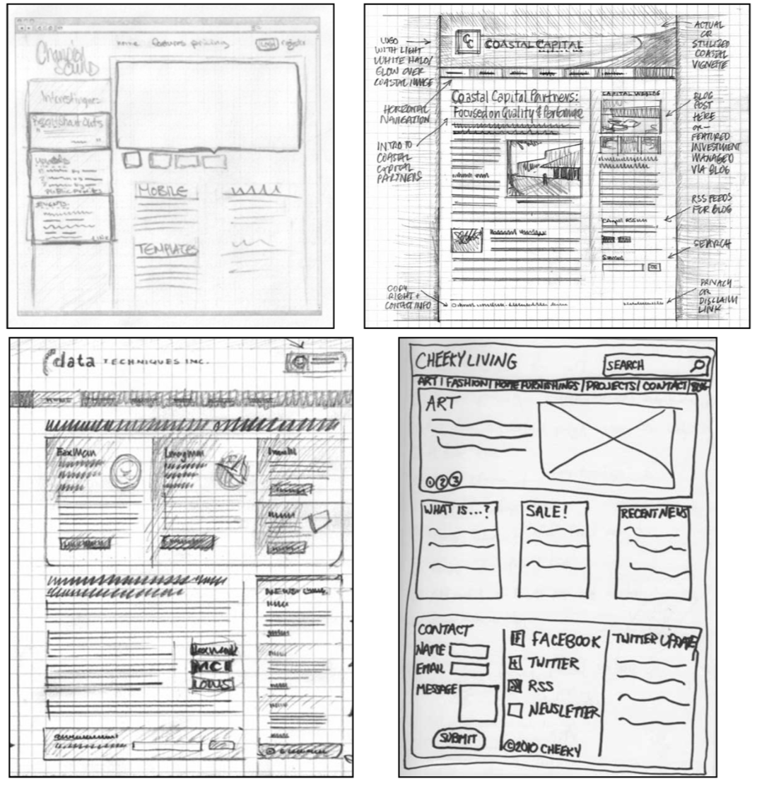

# 🌐 Final Project

**Course:** AMEC 2050 — Web Design I
**Due:** Five milestones, from Week 7 to the end of the semester. Due dates are in Canvas.
**Points:** 250 total (70 for milestones, 180 for the finished site)

## 🎯 Overview

You'll plan, design, and build a brand-new website of at least four pages on a topic you
choose. The project is broken into five milestones: you propose a topic and audience and sketch
wireframes, build the layout, add your real content and images, submit a rough draft for
feedback, and then turn in the finished site. Everything happens in this one repo, and each
milestone is submitted as its own pull request.

Simple, well-organized ideas often make the strongest websites. Aim for clarity, purpose,
and creativity rather than something overly complex.

## 📋 Project Requirements

Your finished site must:

- [ ] Have at least **four pages**: a homepage (`index.html`) plus three or more other pages
- [ ] Be a **brand-new site**, not a modified version of a class exercise (like the Ocarina of
      Time Guide or Graeter's Scoop Shop)
- [ ] Have a clearly defined **topic, purpose, and target audience**, as described in your
      proposal
- [ ] Use **HTML** for structure and **one shared stylesheet**, `css/style.css`, for all
      styling and layout
- [ ] Have a **consistent, visually cohesive design** and the same navigation on every page
- [ ] Work on a **phone and a desktop**, built mobile-first, with no sideways scrolling
- [ ] Be **live on GitHub Pages** from your `develop` branch

## 📂 Repo Layout

| File / Folder | Purpose |
| --- | --- |
| `index.html` | Your homepage. Must be in the root folder and named exactly `index.html`. |
| `*.html` | Your other pages, in the root folder, lowercase with no spaces |
| `css/style.css` | Your one shared stylesheet for every page |
| `images/` | Every image your site uses |
| [`planning/README.md`](../planning/README.md) | Your proposal (FP1) |
| [`planning/WIREFRAMES.md`](../planning/WIREFRAMES.md) | Wireframe tips and examples (FP1) |
| [`planning/wireframe-template.pdf`](../planning/wireframe-template.pdf) | The blank wireframe template (FP1) |
| `planning/wireframes.pdf` | Your wireframes (FP1) |
| `planning/CONTENT.md` | Your page titles, written content, and image list (FP3) |

## 🗓️ Milestones

Every milestone is submitted the same way: commit and push to `develop`, open a pull
request from `develop` into `main` titled with the milestone's name, and submit the pull
request URL in Canvas. Your instructor merges it after grading. The steps are in the
[README](../README.md#-submitting-a-milestone).

| # | Milestone | Points |
| --- | --- | --- |
| FP1 | Proposal & Wireframes | 20 |
| FP2 | Layout | 20 |
| FP3 | Content & Images | 10 |
| FP4 | Rough Draft | 20 |
| FP5 | Final Project | 180 |
| | **Total** | **250** |

Click a milestone below to open it. Focus on one at a time.

<strong>FP1: Proposal & Wireframes (20 points)</strong>

**Pull request title:** `FP1: Proposal & Wireframes`

Your proposal and wireframes are the plan for everything that follows. The proposal defines
your topic, audience, and goals. The wireframes turn that plan into a blueprint for each
page. A builder wouldn't pour concrete without blueprints, and you shouldn't start coding
without wireframes. The more specific and thoughtful your plan, the smoother the rest of the
project will go.

#### What to Do

1. **Read pages 455–460 of your textbook** before you write your proposal.
2. **Set up your repo** by following [Getting Started](../README.md#-getting-started-fp1) in
   the README. This includes creating your repo from the template, creating `develop`,
   turning on GitHub Pages, and adding your live site to the repo's **About** section.
3. **Fill in `planning/README.md`.** Answer each prompt under its heading:
   - **Site Topic & Purpose:** What is your site about, and why does it exist? What do you
     want visitors to do or learn? A clear purpose guides your content, tone, and design.
     For example, a photography business site showcases a portfolio so potential clients
     can view work and book a session.
   - **Target Audience:** Who will visit your site? What are they trying to learn, find, or
     do? What tone or style would appeal to them? Read pages 455–456 first.
   - **Audience Goals:** List the **top three** things your audience will be looking for.
     Be specific and focus on what they need, not just what you want to include.
     - ✅ Good: *View my photography portfolio*, *Read about pricing and packages*,
       *Contact me for booking*
     - ❌ Too vague: *Learn about me*, *See pictures*, *Click around*
   - **Page Layout:** Choose where your navigation goes on wider screens: **below** the
     header, **inside** the header, or down the **left side**. Familiar layouts help
     visitors understand your site right away.
   - **A Site You Like:** Share the URL of a website you like and explain what you like
     about it (layout, colors, navigation, tone, etc.).
4. **Draw your wireframes** on the [wireframe template](../planning/wireframe-template.pdf).
   The [wireframes guide](../planning/WIREFRAMES.md) has download and drawing tips, plus the
   examples below.
   - Start with the **phone** layout, then draw the **desktop** layout, for your homepage
     and at least one other page.
   - Show the box structure: header, navigation, main content, sections, and footer.
     **Label each box with the HTML element it will become**, like `header`, `nav`, `main`,
     `section`, or `footer`.
   - Show where text goes (squiggly lines) and where images go (boxes with an X or an
     "image" label).
   - Include the site name or logo in its approximate position, and list the links in your
     navigation.
   - Keep the organization and proportions intentional. The boxes don't have to be perfect,
     but they should line up and the spacing should make sense.
5. **Choose how to make them:**
   - **By hand:** print the template, draw neatly with a dark pen or marker, then scan the
     pages into a PDF with [Adobe Scan](https://www.adobe.com/acrobat/mobile/scanner-app.html)
     or another PDF app.
   - **Digitally:** open the template in Adobe Illustrator, Figma (free with your UC email),
     or draw.io. Use the rectangle and text tools, then export to PDF.
6. **Save your PDF** in `planning/` as `wireframes.pdf`.

If someone else could build your site just by looking at your wireframes, you've done this
right.

#### 🖼️ Examples

These hand-drawn wireframes show clear box structure, squiggly lines for text, boxed
images, labeled sections, and a visible navigation bar.

#### ✅ Before You Submit

- [ ] Your repo was created from the template and is **Public**
- [ ] Your live GitHub Pages site loads from the `develop` branch
- [ ] Your live site link shows in the repo's **About** section
- [ ] Every section of `planning/README.md` is filled in with specific answers
- [ ] Your topic is a brand-new site, not a modified class exercise
- [ ] Your wireframes cover phone and desktop, every box is labeled with its HTML element,
      and the navigation links are listed
- [ ] `planning/wireframes.pdf` is in the repo and opens on GitHub

#### 🧮 Grading

| Criteria | Full credit looks like | Points |
| --- | --- | --- |
| **Topic & Purpose** | The topic is clear and the purpose explains what visitors should do or learn and why the site is useful. | 2 |
| **Target Audience** | The audience is specific, with their interests, needs, and the tone that would appeal to them. | 2 |
| **Audience Goals** | Three specific, audience-focused goals that could each be answered by a page or section of the site. | 3 |
| **Page Layout & A Site You Like** | One navigation layout is chosen, and a working URL comes with a short explanation of what you like about the site. | 1 |
| **Wireframe Structure** | Phone and desktop layouts show the header, navigation, main content, sections, and footer with intentional proportions, and each box is labeled with its HTML element. | 5 |
| **Content Placement** | Text and image areas are clearly marked, and the site name or logo is placed. | 2 |
| **Navigation** | The navigation's position and links are shown and match the layout in your proposal. | 2 |
| **Craftsmanship** | The wireframes are neat and legible enough to hand to another person to build from. | 1 |
| **Setup & Submission** | The repo is set up from the template, the Pages site is live from `develop` and linked in **About**, the PDF is at `planning/wireframes.pdf`, and the FP1 pull request has its template filled in. | 2 |
| | **Total** | **20** |

<strong>FP2: Layout (20 points)</strong>

**Pull request title:** `FP2: Layout`

Now you turn your wireframes into real web pages. Nothing needs to be final yet. The goal
is to build every page's structure and get your mobile-first layout working with CSS.
Placeholder text is fine for now. Your real content goes in during FP3.

#### What to Do

1. **Create every page for your site** in the root folder, following your wireframes.
   - Your homepage must be named `index.html`.
   - All file names are lowercase with no spaces (use `-` if needed).
   - Each page has a complete `head`: `<!DOCTYPE html>`, `html` with `lang`, `meta charset`,
     the viewport `meta` tag, a unique `title`, and a `meta` description.
   - Each page has its layout elements: `header`, `nav`, `main`, `footer`, and the
     `section`s from your wireframes.
   - Each page has its headings, and placeholder text or images where the real content
     will go.
2. **Link one shared stylesheet.** Create `css/style.css` and link it in every page.
3. **Build the layout mobile-first.**
   - Your base CSS is the phone layout from your wireframes.
   - Use Flexbox or Grid to arrange the page.
   - Add at least one `@media (min-width: …)` breakpoint that rearranges the page into your
     desktop layout.
   - Code your navigation bar so it works on every page, on a phone and on a desktop.
   - Add some visual styling: background colors, borders, spacing, etc. Colors and fonts
     don't need to be final yet.

> 💡 **Tip:**
> Once your homepage works, the other pages are much easier. Copy its HTML to each new
> page. The `header`, `nav`, and `footer` stay the same; only what's inside `main`
> changes. Keep your file paths consistent so images and stylesheets work on every page.

#### ✅ Before You Submit

- [ ] Your homepage is named `index.html`
- [ ] Every page has a complete `head`, including the viewport tag, a `title`, and a
      description
- [ ] Every page has its layout elements and headings
- [ ] Your navigation bar links to every page and works from every page
- [ ] The layout matches your phone wireframe on a phone and your desktop wireframe on a
      wide screen, with no sideways scrolling
- [ ] `style.css` loads on the live site

#### 🧮 Grading

| Criteria | Full credit looks like | Points |
| --- | --- | --- |
| **Files** | Every HTML page and `css/style.css` exist. The homepage is `index.html`, and file and folder names are lowercase with no spaces or special characters. | 3 |
| **HTML Structure** | Every page has a complete `head` (including the viewport tag, a unique `title`, and a description), its layout elements (`header`, `nav`, `main`, `footer`), and its headings. | 5 |
| **Layout** | The base CSS is the phone layout, Flexbox or Grid puts every section in its place, and at least one `min-width` breakpoint rearranges the page to match the desktop wireframe. | 6 |
| **Navigation** | The navigation bar is fully coded, links to every page, and works on a phone and a desktop. | 3 |
| **Submission** | Every page, the stylesheet, and all folders are pushed to `develop` and show in the FP2 pull request, and the pull request has its template filled in. | 3 |
| | **Total** | **20** |

<strong>FP3: Content & Images (10 points)</strong>

**Pull request title:** `FP3: Content & Images`

Time to replace the placeholders. Add your real text and images to every page, so your
rough draft is built around real content instead of guesses.

#### What to Do

1. **Write your content in `planning/CONTENT.md`.** For each page, list its file name, its
   `title`, its headings, and the real written content: paragraphs, lists, and any other
   text. Proofread it.
2. **Add the content to your pages.** Replace every placeholder with your real text, marked
   up by meaning: headings, paragraphs, lists, and so on.
3. **Add your images.**
   - Put every image in `images/`, with lowercase file names and no spaces, like
     `team-photo.webp`.
   - If you can, pick images that aren't huge. A full-size photo from a phone can make a page
     slow to load. This isn't graded.
   - Give every `img` a `width`, a `height`, and meaningful `alt` text, or `alt=""` if it's
     only decoration.
4. **List your images in `planning/CONTENT.md`.** For each image, give the file name, the
   page it goes on, its `alt` text, and where it came from, with its license or credit if
   it isn't your own photo.

#### ✅ Before You Submit

- [ ] Every page has real, proofread text. No placeholder text is left.
- [ ] Every page's `title` and description describe its real content
- [ ] Your images are in `images/`, with lowercase names and no spaces
- [ ] Every `img` has a `width`, a `height`, and the right `alt` text
- [ ] Every image is listed in `CONTENT.md` with its page, `alt` text, and source

#### 🧮 Grading

| Criteria | Full credit looks like | Points |
| --- | --- | --- |
| **Written Content** | Every page has real, proofread text organized under headings, and it serves the audience goals in your proposal. | 4 |
| **Images** | The images are in `images/`, relate to the content, use proper file names, and have `width`, `height`, and the right `alt` text. | 3 |
| **Sources** | Every image is listed in `CONTENT.md` with its page and source, and images that aren't yours are credited. | 2 |
| **Submission** | The FP3 pull request has its template filled in. | 1 |
| | **Total** | **10** |

<strong>FP4: Rough Draft (20 points)</strong>

**Pull request title:** `FP4: Rough Draft`

Your site should be well underway by now. The rough draft is a checkpoint. It doesn't have
to be perfect, but it should be close enough that you can use the feedback to polish
everything before the final version. Classmates will also test it in the Rough Draft Peer
Review discussion.

#### What to Do

Your rough draft should have:

- At least four HTML pages with working navigation links
- Real content (headings, paragraphs, images), not placeholder text
- A mobile-first layout that works on a phone and a desktop
- Styling with colors, fonts, and backgrounds mostly in place
- A favicon on every page, added with a `link rel="icon"` element
- Every link working and every page loading on the live site

> 💡 **Tip:**
> Preview your site in a browser, not just in WebStorm's built-in preview, and check it on your phone. Commit
> and push often instead of all at the end.

#### 🚫 Common Issues to Avoid

- Broken links or images that don't show up (check your file paths)
- Images without an `alt` attribute
- Missing or incomplete pages. You need at least four.
- Placeholder content left on a page
- A homepage that isn't named `index.html`
- Links or buttons you can't reach with the <kbd>Tab</kbd> key, or can't see focus on
- A page that scrolls sideways on a phone

#### ✅ Before You Submit

Your classmates will use this same checklist in the peer review.

- [ ] Do all links work?
- [ ] Can you reach every link and button with <kbd>Tab</kbd>, and see where focus is?
- [ ] Does every page fit at phone width without sideways scrolling?
- [ ] Do images have `alt` text?
- [ ] Does every page have a `title`, a `meta` description, and a favicon?

#### 🧮 Grading

| Criteria | Full credit looks like | Points |
| --- | --- | --- |
| **Pages & Navigation** | At least four pages exist, and the navigation works from every page. | 4 |
| **Content** | Pages have real text and final images, not placeholder content. | 4 |
| **Layout** | The mobile-first layout is fully established and works from a phone to a wide desktop. | 5 |
| **Styling** | Colors, fonts, and spacing are mostly done; only small fixes and final touches are left. | 3 |
| **Checklist** | Every item on the checklist above passes: links, keyboard focus, phone width, `alt` text, and each page's `title`, description, and favicon. | 2 |
| **Testing & Submission** | Links and images work on the live site, and the FP4 pull request has its template filled in. | 2 |
| | **Total** | **20** |

<strong>FP5: Final Project (180 points)</strong>

**Pull request title:** `FP5: Final Project`

Your final submission brings together everything from your proposal and wireframes, layout,
content, and rough draft. Now it's time to show off a complete, polished website that
uses everything you've learned this semester.

#### What to Do

- **Complete site structure:** at least four pages (homepage + three more), each with the
  purpose and content from your proposal.
- **Design and layout:** appropriate HTML elements, CSS for styling and layout, and a
  cohesive, user-friendly design. Pay attention to spacing, alignment, and color.
- **Consistency and functionality:** every link works, every image displays with `alt`
  text, and navigation is intuitive and the same on every page.
- **Audience and content:** the site meets the needs of the audience in your proposal, and
  each page's title and content reflect that focus.

#### 💡 Tips and Common Pitfalls

- **Homepage name:** your homepage must be named `index.html`.
- **Page titles:** give every page a unique, descriptive title. The homepage title is the
  site's name, not "Home" or "Homepage".
- **One stylesheet:** every page shares the same external CSS file.
- **Alt text:** every image needs an `alt` attribute.
- **No spacing with HTML:** use CSS margins and padding, not repeated ` ` tags.
- **Clear navigation:** visitors can reach every section of your site from any page.
- **Proofread:** check spelling and grammar on every page.
- **Image sizes:** when you have a choice, use a smaller version of an image so pages load
  quickly. This isn't graded.
- **Meaningful class names:** use names like `.header-nav` or `.footer-links`, not
  `.style1` or `.main`.
- **Limited fonts and colors:** too many fonts or clashing colors look cluttered.
- **Test every link:** internal and external.

#### ✅ Before You Submit

- [ ] Your homepage is named `index.html` and is in the root folder
- [ ] Every page has a unique, descriptive `<title>`, and the homepage title is the site's name
- [ ] Every page links `css/style.css`, and has no internal or inline styles
- [ ] Every page has a `meta` description and a favicon
- [ ] The navigation bar is the same on every page and every link works
- [ ] Every image loads and has `alt` text
- [ ] Spacing is done with CSS margins and padding, not ` ` tags
- [ ] Class and ID names describe what they're for
- [ ] You've proofread every page for spelling and grammar
- [ ] You've checked the live site on a computer **and** a phone, with no sideways scrolling
- [ ] Everything is committed and pushed to `develop` before you open your final pull request

#### 🧮 Grading Rubric

| Criteria | Full credit looks like | Points |
| --- | --- | --- |
| **Web Standards** | Page layout uses HTML5 semantic elements (`header`, `nav`, `main`, `article`, `section`, `footer`), with a `div` only when one is needed. Spacing comes from CSS margins and padding, not repeated ` ` tags. | 20 |
| **Semantic Markup** | Markup describes the content inside it. There are no presentational tags or outdated attributes like `align="right"`, and no extra `div`s or `section`s. The code is your own, not a modified class exercise or a copied template. | 20 |
| **CSS** | Every page links the same external stylesheet. There are no internal or inline styles. The layout is mobile-first and works from a phone to a wide desktop. Class and ID names describe their purpose and are only added where needed. The CSS is your own. | 20 |
| **Links** | Every link works. Link text says where the link goes (no "click here" or bare URLs). Links are styled to match the site's color scheme and only open new tabs when that makes sense. | 20 |
| **Images** | Every image loads and has `src` and a meaningful `alt`. Images relate to the content, and are integrated with the text. Background images are used where appropriate. | 20 |
| **Page Titles** | Every page has a unique `<title>` and a `meta` description that describe its content, and a favicon. The homepage title is the name of the site, not "Home" or "Index". | 20 |
| **Focus & Purpose** | The site has a clear purpose, theme, or main idea that matches your proposal. It could work outside the context of this class. | 10 |
| **Home Page** | The homepage is visually attractive, clearly explains the site's purpose, and orients visitors. | 10 |
| **Navigation** | Every page has the same navigation bar, in the same order, including a link back to the homepage. It works on a phone and a desktop. Links are easy to understand and have hover and focus states. | 10 |
| **Writing** | Writing is clear and interesting, with correct grammar and spelling. Headings, subheads, and lists make the content easy to scan. | 10 |
| **Readability** | Text is easy to read: font, size, and line height are styled, contrast is strong, and backgrounds don't compete with the text. | 10 |
| **Information** | Each page has enough content to justify itself without overwhelming visitors. Headings stand out from body text and break content into chunks. | 10 |
| | **Total** | **180** |

Each criterion is graded on your live GitHub Pages site and the code in your final pull
request. Partial credit is given for work that is close but not all the way there, such as
one broken link or a few images missing `alt` text.

## 📚 Resources

- Textbook pages 455–460 (read before FP1)
- [Wireframe template](../planning/wireframe-template.pdf) and [examples](../planning/WIREFRAMES.md)
- The PDF handout packet: page layout templates and navigation bar recipes for the three
  most common layouts
- [Adobe Scan](https://www.adobe.com/acrobat/mobile/scanner-app.html) for turning
  hand-drawn wireframes into a PDF

## 🆘 Getting Help

<!-- TODO: office hours, discussion board, tutoring center, etc. -->

---

Setup steps, the AI policy, and how to submit each milestone are in the [README](../README.md).
