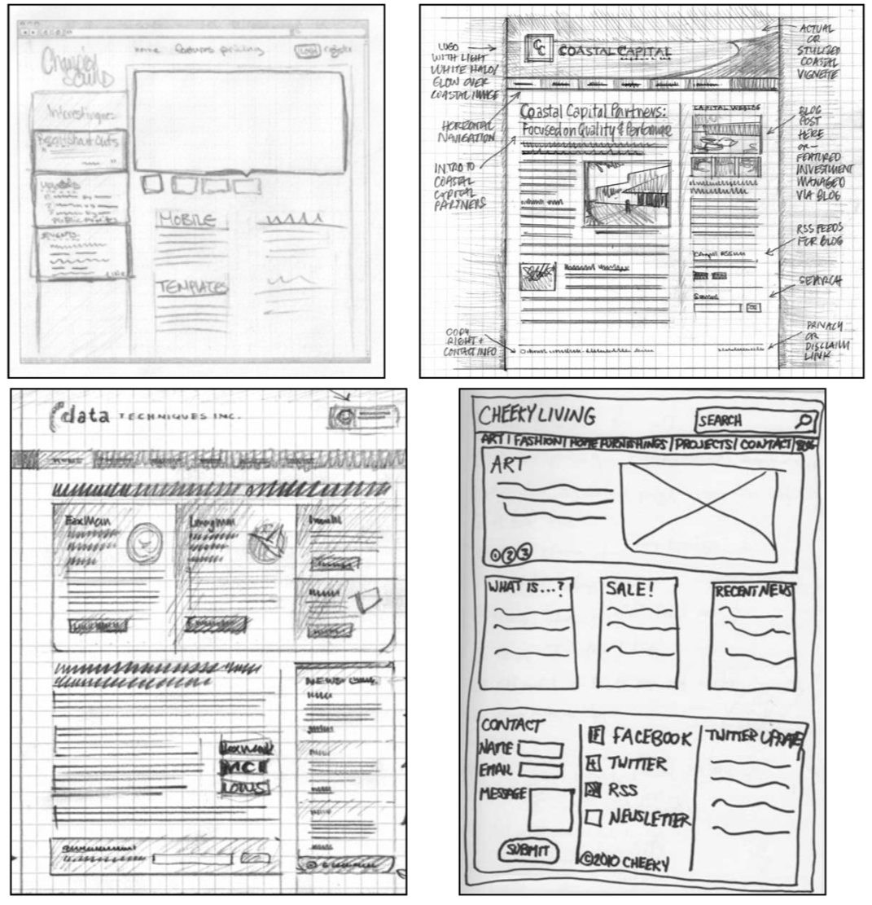

# 🌐 Final Project

**Course:** AMEC 2050 — Web Design I
**Due:** Six milestones over the last weeks of the semester. Due dates are in Canvas.
**Points:** 250 total (70 for milestones, 180 for the finished site)

## 🎯 Overview

You'll plan, design, and build a brand-new website of at least four pages on a topic you
choose. The project is broken into six milestones: you propose a topic and audience, sketch
wireframes, write your content, build the page framework, submit a rough draft for
feedback, and then turn in the finished site. Everything happens in this one repo, and each
milestone is submitted as its own pull request.

Simple, well-organized ideas often make the strongest websites. Aim for clarity, purpose,
and creativity rather than something overly complex.

## 📋 Project Requirements

Your finished site must:

- [ ] Have at least **four pages**: a homepage (`index.html`) plus three or more other pages
- [ ] Be a **brand-new site**, not an update of your earlier personal homepage or a modified
      version of a class exercise (like Vent Haven or the Flower Page)
- [ ] Have a clearly defined **topic, purpose, and target audience**, as described in your
      proposal
- [ ] Use **HTML** for structure and **one shared external CSS file** (plus `reset.css`) for
      all styling and layout
- [ ] Have a **consistent, visually cohesive design** and the same navigation on every page
- [ ] Be **live on GitHub Pages** from your `develop` branch

## 📂 Repo Layout

| File / Folder | Purpose |
| --- | --- |
| `index.html` | Your homepage. Must be in the root folder and named exactly `index.html`. |
| `*.html` | Your other pages, in the root folder, lowercase with no spaces |
| `css/reset.css` | A copy of the reset stylesheet (don't edit it) |
| `css/style.css` | Your one shared stylesheet for every page |
| `images/` | Every image your site uses, resized for the web |
| `planning/PROPOSAL.md` | Your proposal (FP1) |
| [`planning/wireframes/`](planning/wireframes/) | Your wireframes (FP2), the blank wireframe template, and examples |
| `planning/CONTENT.md` | Your page titles, written content, and image list (FP3) |

## 🗓️ Milestones

Every milestone is submitted the same way: commit and push to `develop`, open a pull
request from `develop` into `main` titled with the milestone's name, and submit the pull
request URL in Canvas. Your instructor merges it after grading. The steps are in the
[README](README.md#-submitting-a-milestone).

| # | Milestone | Points |
| --- | --- | --- |
| FP1 | Proposal & Repo Setup | 10 |
| FP2 | Wireframes | 10 |
| FP3 | Content & Images | 10 |
| FP4 | Basic Framework | 20 |
| FP5 | Rough Draft | 20 |
| ⭐ | Final Project | 180 |
| | **Total** | **250** |

Click a milestone below to open it. Focus on one at a time.

<strong>FP1: Proposal & Repo Setup (10 points)</strong>

**Pull request title:** `FP1: Proposal & Repo Setup`

Your proposal is the first step in your final project. It defines your topic, audience, and
design direction before you start your wireframes. The more specific and thoughtful your
answers, the smoother the rest of the project will go.

#### What to Do

1. **Read pages 455–460 of your textbook** before you write your proposal.
2. **Set up your repo** by following [Getting Started](README.md#-getting-started-fp1) in
   the README. This includes creating your repo from the template, creating `develop`,
   turning on GitHub Pages, and adding your live site to the repo's **About** section.
3. **Fill in `planning/PROPOSAL.md`.** Answer each prompt under its heading:
   - **Site Topic & Purpose:** What is your site about, and why does it exist? What do you
     want visitors to do or learn? A clear purpose guides your content, tone, and design.
     For example, a photography business site showcases a portfolio so potential clients
     can view work and book a session.
   - **Target Audience:** Who will visit your site? What are they trying to learn, find, or
     do? What tone or style would appeal to them? Read pages 455–456 first.
   - **Audience Goals:** List the **top three** things your audience will be looking for.
     Be specific and focus on what they need, not just what you want to include.
     - ✅ Good: *View my photography portfolio*, *Read about pricing and packages*,
       *Contact me for booking*
     - ❌ Too vague: *Learn about me*, *See pictures*, *Click around*
   - **Page Layout:** Choose one of the three common layouts: header with the navigation
     bar **below** it, header with the navigation bar **inside** it, or a **left-side**
     navigation bar. Familiar layouts help visitors understand your site right away.
   - **A Site You Like:** Share the URL of a website you like and explain what you like
     about it (layout, colors, navigation, tone, etc.).

#### ✅ Before You Submit

- [ ] Your repo was created from the template and is **Public**
- [ ] Your live GitHub Pages site loads from the `develop` branch
- [ ] Your live site link shows in the repo's **About** section
- [ ] Every section of `planning/PROPOSAL.md` is filled in with specific answers
- [ ] Your topic is a brand-new site, not your earlier personal homepage

#### 🧮 Grading

| Criteria | Full credit looks like | Points |
| --- | --- | --- |
| **Topic & Purpose** | The topic is clear and the purpose explains what visitors should do or learn and why the site is useful. | 2 |
| **Target Audience** | The audience is specific, with their interests, needs, and the tone that would appeal to them. | 2 |
| **Audience Goals** | Three specific, audience-focused goals that could each be answered by a page or section of the site. | 3 |
| **Page Layout** | One of the three layouts is chosen. | 1 |
| **A Site You Like** | A working URL and a short explanation of what you like about the site. | 1 |
| **Setup & Submission** | The repo is set up from the template, the Pages site is live from `develop` and linked in **About**, and the FP1 pull request has its template filled in. | 1 |
| | **Total** | **10** |

<strong>FP2: Wireframes (10 points)</strong>

**Pull request title:** `FP2: Wireframes`

Wireframes are the blueprint for your website. They plan the structure and flow of your
pages before you write any code. A builder wouldn't pour concrete without blueprints, and
you shouldn't start coding without wireframes. If you rush this step, you'll waste time
later guessing about layout while you're coding.

#### What to Do

1. Use the [wireframe template](planning/wireframes/wireframe-template.pdf). The [wireframes folder](planning/wireframes/) has download and drawing tips, plus the examples below.
2. Draw a **desktop** and a **phone** wireframe for your pages. Each wireframe should:
   - Clearly show the box structure: header, navigation, main content, footer, and any
     sections or `div`s
   - Show where text goes (squiggly lines) and where images go (boxes with an X or an
     "image" label)
   - Include the site name or logo in its approximate position
   - Show the navigation bar (below the header, inside it, or on the left side) and the
     links it will contain
   - Have intentional organization and proportions. The boxes don't have to be perfect,
     but they should line up and the spacing should make sense.
   - Label key elements so it's obvious what each section is
3. Choose how to make them:
   - **By hand:** print the template, draw neatly with a dark pen or marker, then scan the
     pages into a PDF with [Adobe Scan](https://www.adobe.com/acrobat/mobile/scanner-app.html)
     or another PDF app.
   - **Digitally:** open the template in Adobe Illustrator, Figma (free with your UC email),
     or draw.io. Use the rectangle and text tools, then export to PDF.
4. Save your PDF in `planning/wireframes/` with a lowercase name, like `wireframes.pdf`.

If someone else could build your site just by looking at your wireframes, you've done this
right.

#### 🖼️ Examples

These hand-drawn wireframes show clear box structure, squiggly lines for text, boxed
images, labeled sections, and a visible navigation bar.

#### ✅ Before You Submit

- [ ] Your wireframes cover desktop and phone
- [ ] Every element is labeled, and the navigation links are listed
- [ ] Someone unfamiliar with your project could tell where each element goes
- [ ] The PDF is in `planning/wireframes/` and opens on GitHub

#### 🧮 Grading

| Criteria | Full credit looks like | Points |
| --- | --- | --- |
| **Page Structure** | The header, navigation, main content, sections, and footer are clearly laid out with intentional proportions. | 3 |
| **Content Placement** | Text and image areas are clearly marked, and the site name or logo is placed. | 2 |
| **Navigation** | The navigation bar's position and links are shown and match the layout in your proposal. | 2 |
| **Labels & Craftsmanship** | The wireframes are neat, legible, and labeled well enough to hand to another person to build from. | 2 |
| **Submission** | The PDF is in `planning/wireframes/`, and the FP2 pull request has its template filled in. | 1 |
| | **Total** | **10** |

<strong>FP3: Content & Images (10 points)</strong>

**Pull request title:** `FP3: Content & Images`

Before you code, gather the real content for your site. Writing your text and preparing
your images now means your rough draft won't be full of placeholder text, and your pages
will be built around real content instead of guesses.

#### What to Do

1. **Plan your pages in `planning/CONTENT.md`.** For each page (at least four), list:
   - The file name, like `index.html` or `services.html` (lowercase, no spaces)
   - The page's `<title>`. The homepage title is the name of your site, not "Home".
   - The page's headings and subheadings
   - The real written content: paragraphs, lists, and any other text. Proofread it.
2. **Prepare your images.**
   - Collect the images your site will use and put them in `images/`.
   - Use lowercase file names with no spaces, like `team-photo.jpg`.
   - Resize and compress large images before you add them. Photos straight from a phone or
     camera are much too big for a web page and slow it down.
3. **List your images in `planning/CONTENT.md`.** For each image, give the file name, the
   page it goes on, its `alt` text, and where it came from (your own photo, or the site you
   got it from).

#### ✅ Before You Submit

- [ ] Every page has a file name, title, headings, and real text in `CONTENT.md`
- [ ] The text is proofread for spelling and grammar
- [ ] Your images are in `images/`, resized, with lowercase names and no spaces
- [ ] Every image is listed with its page, `alt` text, and source

#### 🧮 Grading

| Criteria | Full credit looks like | Points |
| --- | --- | --- |
| **Pages & Titles** | At least four pages are planned, each with a file name and a unique, descriptive title. The homepage title is the site's name. | 2 |
| **Written Content** | Each page has real, proofread text organized under headings, and it serves the audience goals in your proposal. | 4 |
| **Images** | The images are in `images/`, relate to the content, are resized for the web, and use proper file names. | 2 |
| **Alt Text & Sources** | Every image has meaningful `alt` text and a listed source. | 1 |
| **Submission** | The FP3 pull request has its template filled in. | 1 |
| | **Total** | **10** |

<strong>FP4: Basic Framework (20 points)</strong>

**Pull request title:** `FP4: Basic Framework`

Now you start turning your plan into real web pages. Everything doesn't need to be designed
yet. The goal is to build the basic structure for every page and get your page layout
working with CSS.

#### What to Do

1. **Create every page for your site** in the root folder.
   - Your homepage must be named `index.html`.
   - All file names are lowercase with no spaces (use `-` if needed).
   - Each page has a complete HTML structure: `<!DOCTYPE html>`, `<html>`, `<head>`,
     `<body>`, and so on.
   - Each page has its layout elements: `<header>`, `<nav>`, `<main>`, `<footer>`, etc.
   - The page layout templates in your PDF handout packet are a good starting point.
2. **Add your content** from `planning/CONTENT.md`, and some of your images, so you can
   see how the layout fits.
3. **Make progress with CSS.**
   - Link `css/reset.css` and then `css/style.css` in every page.
   - Get your page layout working (flex or grid, margins, padding).
   - Code your navigation bar so it works on every page.
   - Add some visual styling: background colors, borders, spacing, etc. Colors and fonts
     don't need to be final yet.

> 💡 **Tip:**
> Once your homepage works, the other pages are much easier. Copy its HTML to each new
> page. The `<header>`, `<nav>`, and `<footer>` stay the same; only what's inside `<main>`
> changes. Keep your file paths consistent so images and stylesheets work on every page.

#### ✅ Before You Submit

- [ ] Your homepage is named `index.html`
- [ ] Every page has the basic HTML structure and layout elements
- [ ] Your navigation bar links to every page and works from every page
- [ ] `reset.css`, `style.css`, and your images load on the live site
- [ ] Your files and folders are organized and properly named

#### 🧮 Grading

| Criteria | Full credit looks like | Points |
| --- | --- | --- |
| **Files** | Every HTML page and the CSS files are created. The homepage is `index.html`, and file and folder names are lowercase with no spaces or special characters. | 5 |
| **HTML Structure** | Every page has the basic structure (doctype, `head`, `body`), the page layout elements (`header`, `nav`, `main`, `footer`), and most of its written content. | 5 |
| **CSS Progress** | The page layout puts everything in its final location (grid or flex), the navigation bar is fully coded, and some visual styles are applied. | 5 |
| **Submission** | Every required file is pushed to `develop` and shows in the FP4 pull request, including `reset.css`, `style.css`, every page, every image, and all folders, and the pull request has its template filled in. | 5 |
| | **Total** | **20** |

<strong>FP5: Rough Draft (20 points)</strong>

**Pull request title:** `FP5: Rough Draft`

Your site should be well underway by now. The rough draft is a checkpoint. It doesn't have
to be perfect, but it should be close enough that you can use the feedback to polish
everything before the final version.

#### What to Do

Your rough draft should have:

- At least four HTML pages with working navigation links
- Real content (headings, paragraphs, images), not placeholder text
- A CSS layout using grid or flex
- Styling with colors, fonts, and backgrounds mostly in place
- Every link working and every page loading on the live site

> 💡 **Tip:**
> Preview your site in a browser, not just in VS Code, and check it on your phone. Commit
> and push often instead of all at the end.

#### 🚫 Common Issues to Avoid

- Broken links or images that don't show up (check your file paths)
- Images without an `alt` attribute, or with an empty one
- Missing or incomplete pages. You need at least four.
- Placeholder content everywhere
- A homepage that isn't named `index.html`
- A missing copy of `reset.css` in your repo

#### ✅ Before You Submit

- [ ] All four or more pages exist and are linked in the navigation
- [ ] Your content is real, not placeholder text
- [ ] Your layout and most of your styling are in place
- [ ] Every link and image works on the live site

#### 🧮 Grading

| Criteria | Full credit looks like | Points |
| --- | --- | --- |
| **Pages & Navigation** | At least four pages exist, and the navigation works from every page. | 5 |
| **Content** | Pages have real text and final images, not placeholder content. | 5 |
| **Layout** | The page layout is fully established with grid or flex. | 5 |
| **Styling** | Colors, fonts, and spacing are mostly done; only small fixes and final touches are left. | 3 |
| **Testing & Submission** | Links and images work on the live site, and the FP5 pull request has its template filled in. | 2 |
| | **Total** | **20** |

<strong>⭐ Final Project (180 points)</strong>

**Pull request title:** `Final Project`

Your final submission brings together everything from your proposal, wireframes, content,
framework, and rough draft. Now it's time to show off a complete, polished website that
uses everything you've learned this semester.

#### What to Do

- **Complete site structure:** at least four pages (homepage + three more), each with the
  purpose and content from your proposal.
- **Design and layout:** appropriate HTML elements, CSS for styling and layout, and a
  cohesive, user-friendly design. Pay attention to spacing, alignment, and color.
- **Consistency and functionality:** every link works, every image displays with `alt`
  text, and navigation is intuitive and the same on every page.
- **Audience and content:** the site meets the needs of the audience in your proposal, and
  each page's title and content reflect that focus.

#### 💡 Tips and Common Pitfalls

- **Homepage name:** your homepage must be named `index.html`.
- **Page titles:** give every page a unique, descriptive title. The homepage title is the
  site's name, not "Home" or "Homepage".
- **One stylesheet:** every page shares the same external CSS file.
- **Alt text:** every image needs an `alt` attribute.
- **No spacing with HTML:** use CSS margins and padding, not repeated ` ` tags.
- **Clear navigation:** visitors can reach every section of your site from any page.
- **Proofread:** check spelling and grammar on every page.
- **Image sizes:** resize and compress images so pages load quickly.
- **Meaningful class names:** use names like `.header-nav` or `.footer-links`, not
  `.style1` or `.main`.
- **Limited fonts and colors:** too many fonts or clashing colors look cluttered.
- **Test every link:** internal and external.

#### ✅ Before You Submit

- [ ] Your homepage is named `index.html` and is in the root folder
- [ ] Every page has a unique, descriptive `<title>`, and the homepage title is the site's name
- [ ] Every page links `css/reset.css` and then `css/style.css`, and has no internal styles
- [ ] The navigation bar is the same on every page and every link works
- [ ] Every image loads, has `alt` text, and has been resized for the web
- [ ] Spacing is done with CSS margins and padding, not ` ` tags
- [ ] Class and ID names describe what they're for
- [ ] You've proofread every page for spelling and grammar
- [ ] You've checked the live site on a computer **and** a phone
- [ ] Everything is committed and pushed to `develop` before you open your final pull request

#### 🧮 Grading Rubric

| Criteria | Full credit looks like | Points |
| --- | --- | --- |
| **Web Standards** | Page layout uses HTML5 semantic elements (`header`, `nav`, `main`, `article`, `section`, `footer`), with a `div` only when one is needed. Spacing comes from CSS margins and padding, not repeated ` ` tags. | 20 |
| **Semantic Markup** | Markup describes the content inside it. There are no presentational tags or outdated attributes like `align="right"`, and no extra `div`s or `section`s. The code is your own, not a modified class exercise or a copied template. | 20 |
| **CSS** | Every page links the same external stylesheet, plus `reset.css`. There are no internal or inline styles. Class and ID names describe their purpose and are only added where needed. The CSS is your own. | 20 |
| **Links** | Every link works. Link text says where the link goes (no "click here" or bare URLs). Links are styled to match the site's color scheme and only open new tabs when that makes sense. | 20 |
| **Images** | Every image loads and has `src` and a meaningful `alt`. Images are sized and compressed for the web, relate to the content, and are integrated with the text. Background images are used where appropriate. | 20 |
| **Page Titles** | Every page has a unique `<title>` that describes its content. The homepage title is the name of the site, not "Home" or "Index". | 20 |
| **Focus & Purpose** | The site has a clear purpose, theme, or main idea that matches your proposal. It could work outside the context of this class. | 10 |
| **Home Page** | The homepage is visually attractive, clearly explains the site's purpose, and orients visitors. | 10 |
| **Navigation** | Every page has the same horizontal or vertical navigation bar, in the same order, including a link back to the homepage. Links are easy to understand and have a hover state. | 10 |
| **Writing** | Writing is clear and interesting, with correct grammar and spelling. Headings, subheads, and lists make the content easy to scan. | 10 |
| **Readability** | Text is easy to read: font, size, and line height are styled, contrast is strong, and backgrounds don't compete with the text. | 10 |
| **Information** | Each page has enough content to justify itself without overwhelming visitors. Headings stand out from body text and break content into chunks. | 10 |
| | **Total** | **180** |

Each criterion is graded on your live GitHub Pages site and the code in your final pull
request. Partial credit is given for work that is close but not all the way there, such as
one broken link or a few images missing `alt` text.

## 📚 Resources

- Textbook pages 455–460 (read before FP1)
- [Wireframe template](planning/wireframes/wireframe-template.pdf) and [examples](planning/wireframes/README.md)
- The PDF handout packet: page layout templates and navigation bar recipes for the three
  most common layouts
- [Adobe Scan](https://www.adobe.com/acrobat/mobile/scanner-app.html) for turning
  hand-drawn wireframes into a PDF

## 🆘 Getting Help

<!-- TODO: office hours, discussion board, tutoring center, etc. -->

---

Setup steps, the AI policy, and how to submit each milestone are in the [README](README.md).
