# 🌐 Final Project

This repo is home base for your final project. You'll use the same repo for the whole
project, from your proposal and wireframes to the finished website. Each milestone is
submitted as its own pull request, so by the end your repo shows how your site came together.

> [!NOTE]
> `.editorconfig`, `.gitattributes`, `.gitignore`, `.noai`, and the `.github` and `.idea`
> folders are setup files that keep assignments consistent. Leave them alone.

## 📋 Assignment Requirements

> [!IMPORTANT]
> **Start here: [read ASSIGNMENT.md →](.github/ASSIGNMENT.md)**

It has the project requirements and a collapsible section for each milestone with its
instructions, checklist, and grading. Open the milestone you're working on and check it
again before you submit. This `README` covers how to set up your repo, publish your site,
and submit each milestone.

## ⚡ Quick Steps

**Once, at the start:** follow [Getting Started](#-getting-started-fp1) to create your repo,
your `develop` branch, and your live GitHub Pages site.

**Every milestone:**

1. Open the milestone in [ASSIGNMENT.md](.github/ASSIGNMENT.md) and do the work on `develop`.
2. Commit and push in WebStorm, often. Check your live site.
3. Open a pull request from `develop` into `main`, titled with the milestone's name, and fill
   in its template.
4. Paste the pull request URL into the milestone's assignment in Canvas.

The full steps, with screenshots, are in [Saving Your Work](#-saving-your-work) and
[Submitting a Milestone](#-submitting-a-milestone).

## 🗂️ What Goes in This Repo

Your planning documents and your website live side by side:

```
index.html                  ← your homepage (must be in the root folder)
about.html                  ← your other pages (use your own page names)
css/reset.css
css/style.css
images/
planning/PROPOSAL.md        ← FP1: fill in your proposal here
planning/wireframes/        ← FP2: put your wireframe PDF or images here
planning/CONTENT.md         ← FP3: your written content and image list
```

GitHub Pages publishes from the **root folder**, so `index.html` has to live there or your
site will 404. Page file names should be lowercase with no spaces (use `-` if needed).

## 🌿 How the Branches Work

You'll use two branches:

| Branch | What it's for |
| --- | --- |
| `develop` | Where you do **all** of your work. GitHub Pages publishes this branch, so your live site always shows your latest pushed work on your computer or phone. |
| `main` | Your instructor merges each milestone into `main` after grading it. You never commit to `main` yourself. |

For every milestone, you open a new pull request from `develop` into `main`. After your
instructor grades and merges it, your next pull request only shows the work you did since
then. You stay on `develop` the whole time.

## 🏁 Getting Started (FP1)

You only do this once, at the start of the project.

> [!TIP]
> **New to WebStorm?** Do the [one-time WebStorm setup](.github/WEBSTORM_SETUP.md) first.

1. **Create your own repo from this template.**
   - At the top of this repo on GitHub, click the green **Use this template** button. (If a
     menu opens, choose **Create a new repository**.)

     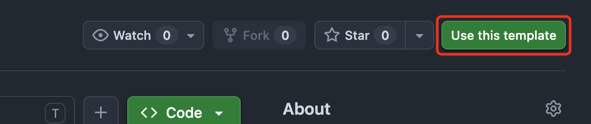
   - Set **Owner** to your GitHub account.
   - Name the repo after your site, like `cincy-music-guide`. You'll use this repo for the
     whole project, so don't name it after a single milestone.

     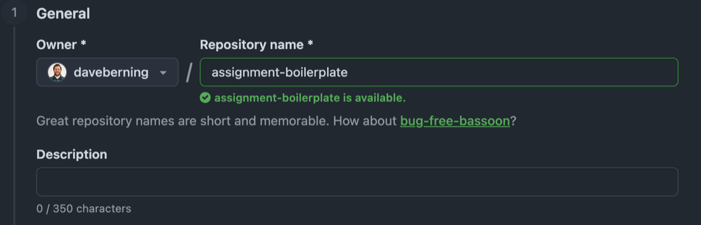
   - Set visibility to **Public** (GitHub Pages needs a public repo on a free account).

     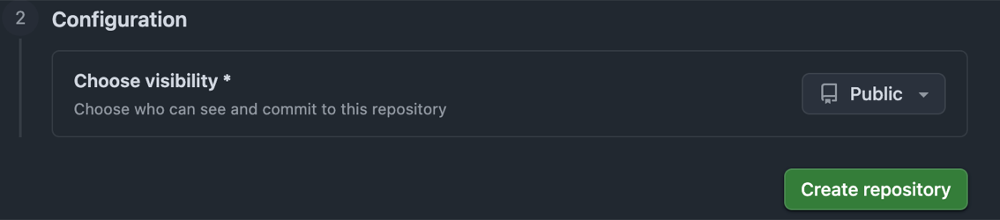
   - Click **Create repository**. GitHub takes you to your new repo.
2. **Clone your new repo in WebStorm.**
   - On the WebStorm welcome screen, click **Clone Repository**. (If a project is already
     open, use **File** → **New** → **Project from Version Control…**)
   - Click **GitHub** on the left. Pick `<your-username>/<repo-name>` from the list, not
     this template.
   - Check the **Directory** it will save to, then click **Clone**.

     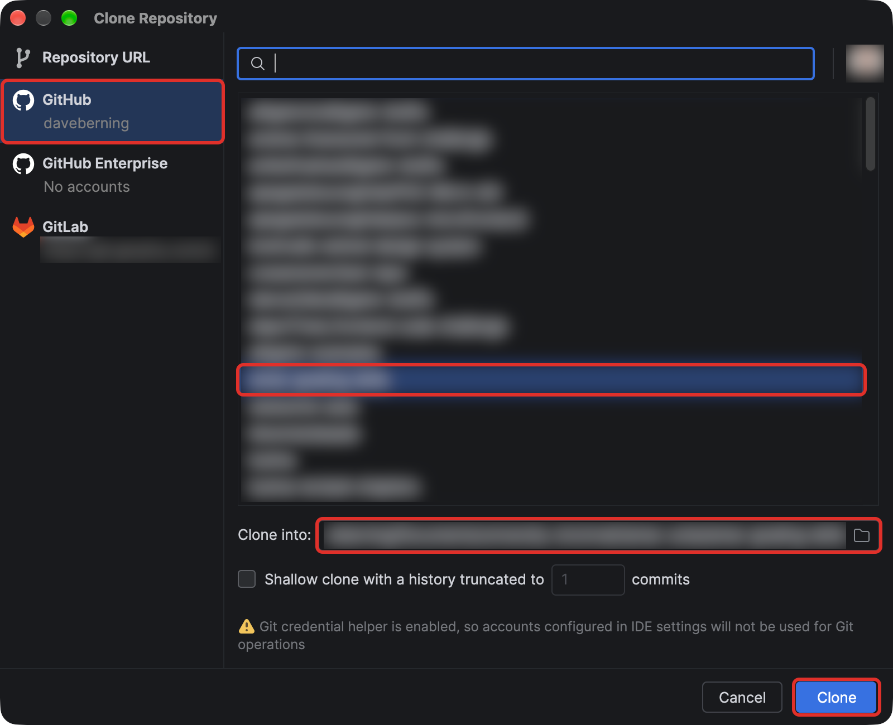
   - If WebStorm asks whether to trust the project, click **Trust Project**.
3. **Create your `develop` branch.** Click the branch name (`main`) at the top left of the
   window, then **New Branch…** Name it `develop`, leave **Checkout branch** checked, and
   click **Create**. Then press <kbd>Cmd</kbd> + <kbd>Shift</kbd> + <kbd>K</kbd> and click
   **Push** to create `develop` on GitHub.

   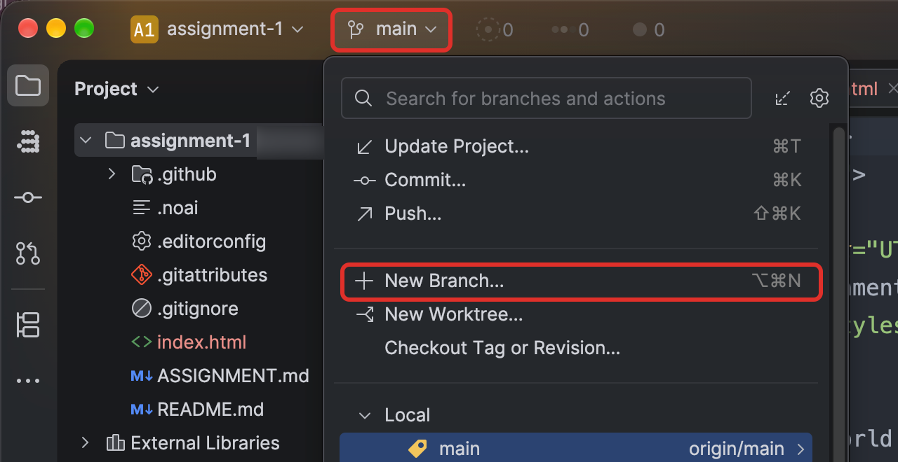
4. **Turn on GitHub Pages** for `develop` using the steps in
   [Publishing to GitHub Pages](#-publishing-to-github-pages) below.
5. **Add your live site to the repo's About section.**
   - On your repo's main page on GitHub, click the ⚙️ gear next to **About** (top right).
   - Check **Use your GitHub Pages website**, then click **Save changes**.
   - Your live site link now shows at the top of your repo, so anyone can find it.
6. Open `planning/PROPOSAL.md` in WebStorm and start on your proposal.

## 🤖 AI Policy

Work on this project must be your own. Do not use AI coding assistants — including
GitHub Copilot, Cursor, ChatGPT, Claude, or JetBrains AI Assistant — to generate,
complete, or rewrite your code, or to write your proposal or site content.

You should be able to explain any line of your submission. You may be asked to do so.

This repo includes a `.noai` file, which disables JetBrains AI Assistant for the project
in IDEs like WebStorm. Leave it in place. It is a reminder of the policy above, not a
substitute for it — following the policy is still your responsibility.

> [!NOTE]
> The `.noai` file does **not** turn off WebStorm's local Full Line code completion. Turn that
> off yourself as part of the [one-time setup](.github/WEBSTORM_SETUP.md) (step 5).

## 💾 Saving Your Work

Commit and push often, not just when a milestone is due.

1. **Commit your work in WebStorm.**
   - Make sure the branch name at the top left says `develop`.
   - Press <kbd>Cmd</kbd> + <kbd>K</kbd> to open the **Commit** panel and check the files you
     want to include.
   - Type a short message, like `Add about page`, and click **Commit**.

   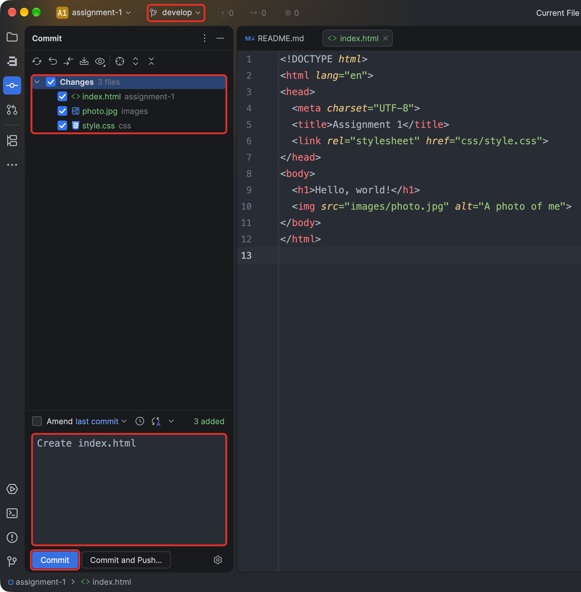

   The first time, WebStorm asks for your name and email, and it may stop to show problems
   it found in your code. [Publishing to GitHub Pages](.github/PUBLISHING.md) shows both.
2. **Push your work to GitHub.** Press <kbd>Cmd</kbd> + <kbd>Shift</kbd> + <kbd>K</kbd> and
   click **Push** after every commit (or click **Commit and Push** to do both). If you only
   commit, your work stays on your computer and your live site won't update.

   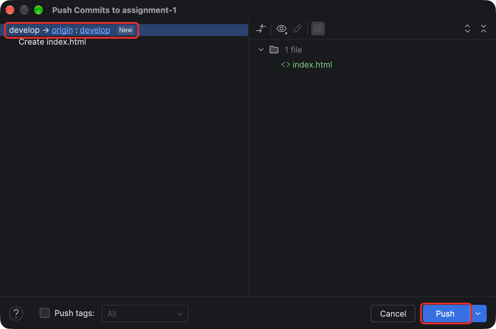

## 🚀 Publishing to GitHub Pages

You set this up once in FP1. After that, every push to `develop` updates your live site.

1. On GitHub, open **your** repo (the one you created from the template) and go to
   **Settings** → **Pages**.
2. Under **Branch**, click the **None** dropdown and pick `develop`.

   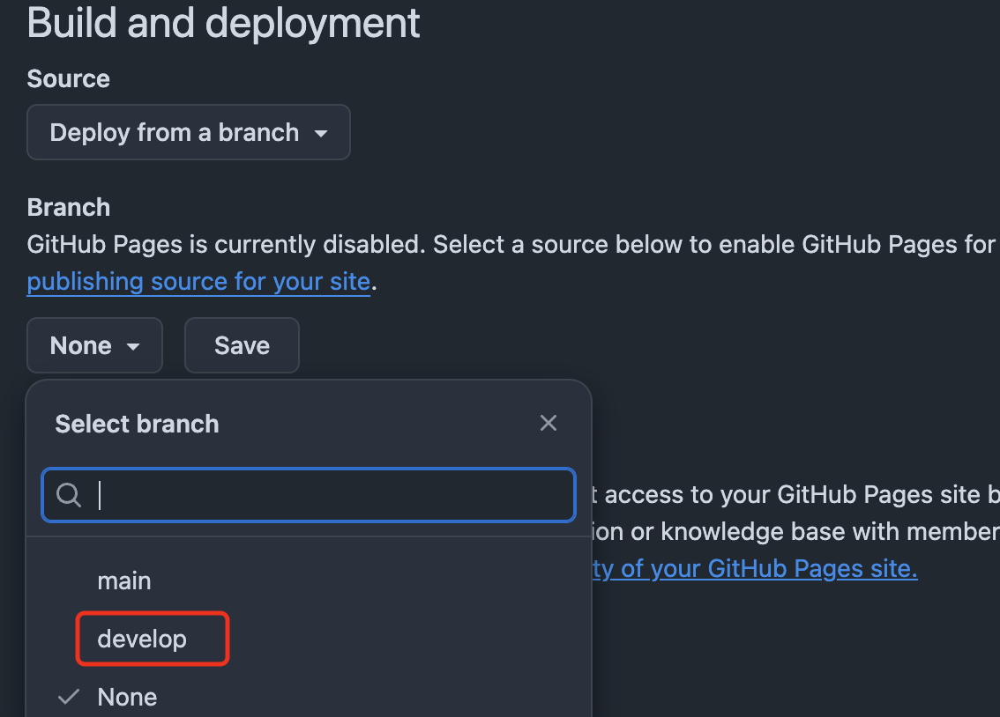
3. Make sure **Source** is *Deploy from a branch* and the folder is `/ (root)`, then click
   **Save**.

   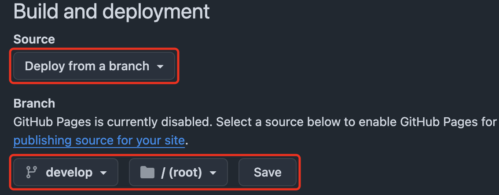
4. The first deploy takes a minute or two. Reload the Pages settings screen until it says
   **Your site is live at**, then click the URL:
   ```
   https://<your-username>.github.io/<repo-name>/
   ```

   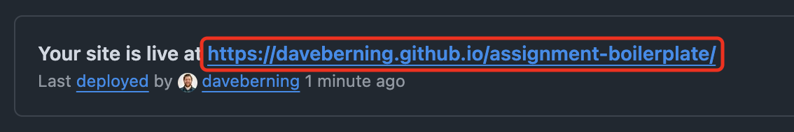

   Until you add an `index.html` (FP4), the live site shows this README instead of a
   homepage. That's expected.

**🛠️ Troubleshooting**

- **404 page:** make sure an `index.html` exists in the root of `develop`, and that the
  filename is lowercase.
- **Old version showing:** Pages caches aggressively. Wait a minute, then hard refresh (<kbd>Cmd</kbd>/<kbd>Ctrl</kbd> + <kbd>Shift</kbd> + <kbd>R</kbd>).
- **Nothing deployed:** check the **Actions** tab for a failed `pages build and deployment` run.
- **Site didn't update:** check that you pushed (not just committed), and that Pages is still
  set to `develop`.

## 📬 Submitting a Milestone

Do this every time a milestone is ready: push your work, open a pull request from `develop`
into `main`, and submit that pull request's URL in Canvas.

1. **Commit and push everything on `develop`.** The branch name at the top left should say
   `develop`, and there should be nothing left to commit or push.
2. **Open a pull request into `main`.**
   - In WebStorm, open the **Git** menu → **GitHub** → **Create Pull Request…** The
     **Pull Requests** panel opens with a new pull request form.

     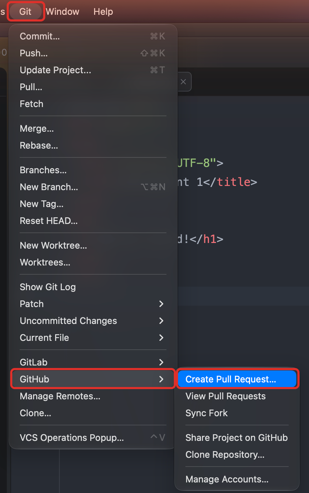
   - At the top of the form, confirm it says `main` ← `develop`. If not, click each branch
     name to change it. Title it with the milestone name, like `FP2: Wireframes`.

     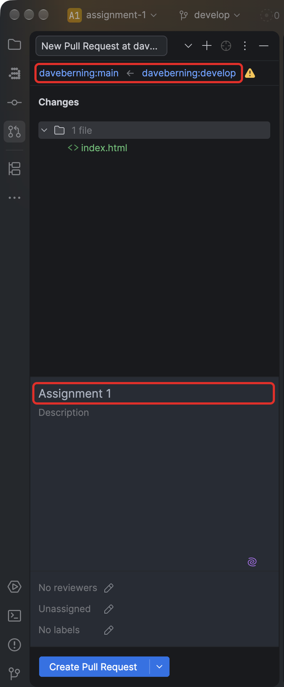
   - The description is pre-filled with a template. Fill in every section: check the
     milestone you're submitting under **Milestone**, paste your live
     GitHub Pages URL under **Live GitHub Pages URL**, write a short **Summary** of what this
     milestone added, check off the **Checklist** by changing each `[ ]` to `[x]`, and
     answer the **Reflection**. **Notes for your instructor** is optional. Leave the
     `<!-- -->` hint lines as they are; they're hidden once the pull request is created.
     If the description is empty, open `.github/pull_request_template.md` in WebStorm, copy
     everything in it, and paste it into the description.
   - Click **Create Pull Request**. Don't use the dropdown's **Create Draft Pull Request**.

     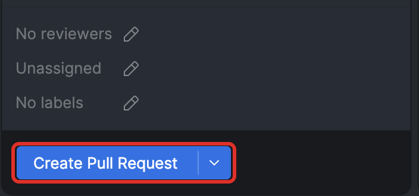
   - Click **Open on GitHub** at the top of the new pull request to see it in your browser.
     It should say **Open**. Don't merge it. Your instructor merges it after grading.

     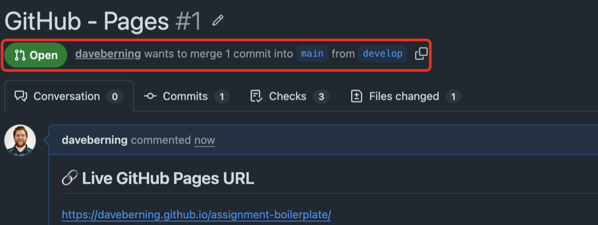
3. **Submit the pull request URL in Canvas.**
   - Copy the pull request URL from your browser's address bar. It looks like
     `https://github.com/<your-username>/<repo-name>/pull/2`.
   - Open the matching milestone assignment in Canvas and click the red
     **Start Assignment** button.

     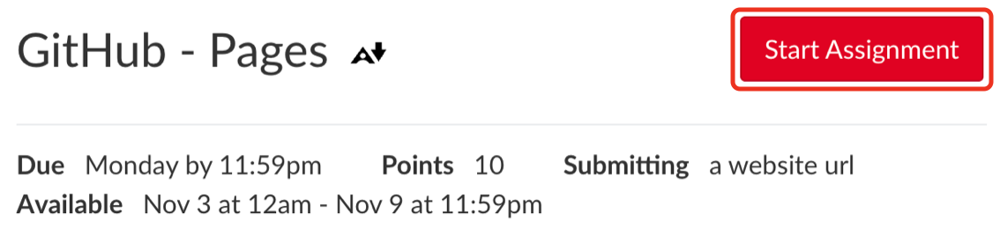
   - On the **Website URL** tab, paste your **pull request URL**. Don't paste your GitHub
     Pages URL or your repo URL here.
   - Click the red **Submit Assignment** button.

     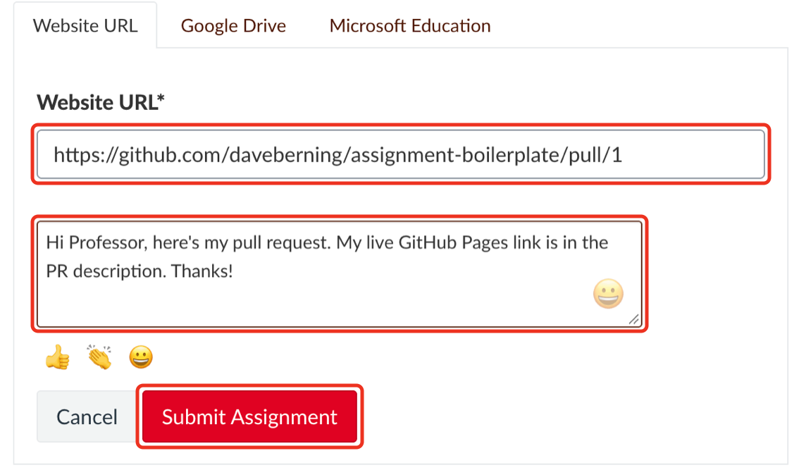
4. **Keep working on `develop`.** There's nothing to switch. Your next commits go into
   the next milestone.

> [!TIP]
> **Need to fix something before the deadline?** Commit and push it to `develop` as usual.
> The open pull request updates on its own, so you don't need to resubmit in Canvas.

> [!NOTE]
> **"A pull request already exists"?** Your last milestone's pull request hasn't been merged
> yet, and GitHub only allows one open pull request from `develop` into `main`. Don't create
> a new one. Submit the URL of the pull request that's already open, and add a comment on it
> saying which milestone you're submitting.

> [!CAUTION]
> Each milestone is graded on what is in its pull request at the deadline. Commits pushed
> after the deadline are marked with their time on the pull request and count toward the
> next milestone, not this one.
