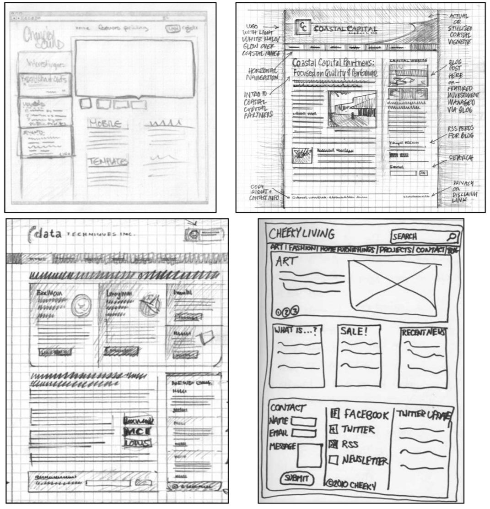

# 📐 Wireframes

Put your **FP2: Wireframes** PDF in this folder, with a lowercase name like
`wireframes.pdf`. The full instructions and grading are in
[ASSIGNMENT.md](../../ASSIGNMENT.md).

## 📄 Wireframe Template

Draw your desktop and phone wireframes on the template:
**[wireframe-template.pdf](wireframe-template.pdf)**

- **By hand:** print it, draw neatly with a dark pen or marker, then scan the pages into a
  PDF with [Adobe Scan](https://www.adobe.com/acrobat/mobile/scanner-app.html) or another
  PDF app.
- **Digitally:** open it in Adobe Illustrator, Figma, or draw.io, draw with the rectangle
  and text tools, then export to PDF.

To download it, open the link above and click the **Download raw file** button (⬇️) at the
top right of the preview.

## 🖼️ Examples

These hand-drawn wireframes show clear box structure, squiggly lines for text, boxed
images, labeled sections, and a visible navigation bar.

